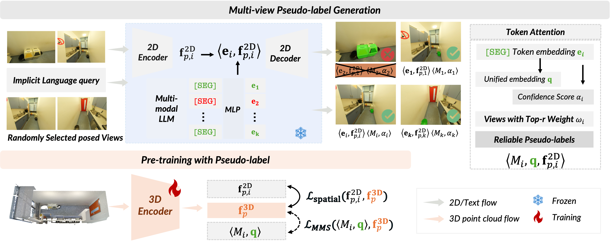

<p align="center">
  
</p>

<h1 align="center">MLLM-For3D: Adapting Multimodal Large Language Model<br>for 3D Reasoning Segmentation</h1>

<p align="center">
  <strong>NeurIPS 2025</strong>
</p>

<p align="center">
  <a href="https://arxiv.org/abs/2503.18135"></a>
  <a href="https://tmllab.github.io/2025_NeurIPS_MLLM-For3D/"></a>
  <a href="https://arxiv.org/pdf/2503.18135"></a>
  <a href="https://github.com/liziwennba/SURPRISE3D"></a>
</p>

<p align="center">
  <a href="#">Jiaxin Huang</a><sup>1,2*</sup>&ensp;
  <a href="#">Runnan Chen</a><sup>1*</sup>&ensp;
  <a href="#">Ziwen Li</a><sup>3</sup>&ensp;
  <a href="#">Zhengqing Gao</a><sup>4</sup>&ensp;
  <a href="#">Xiao He</a><sup>2</sup>&ensp;
  <a href="#">Yandong Guo</a><sup>2</sup>&ensp;
  <a href="#">Tongliang Liu</a><sup>3†</sup>&ensp;
  <a href="#">Mingming Gong</a><sup>5†</sup>
</p>

<p align="center">
  <sup>1</sup>MBZUAI&ensp;<sup>2</sup>AI2Robotics&ensp;<sup>3</sup>University of Sydney&ensp;<sup>4</sup>Texas A&M University&ensp;<sup>5</sup>University of Melbourne<br>
  <sup>*</sup>Equal contribution&ensp;<sup>†</sup>Corresponding authors
</p>

---

## TL;DR

**MLLM-For3D** transfers reasoning capabilities from frozen 2D multimodal large language models (LISA/LISA++) to 3D scene understanding — achieving state-of-the-art 3D reasoning segmentation **without any 3D annotations**. Given a complex natural language query (e.g., *"It's hot, where can I get a cold drink?"*), MLLM-For3D segments the relevant 3D object (the refrigerator) by distilling multi-view pseudo-masks from 2D into 3D space with spatial consistency.

---

## Highlights

- **Label-Free 3D Reasoning** — No manual 3D annotations required; distills reasoning from frozen 2D LISA models.
- **Spatial Consistency Strategy** — Attention-based fusion ensures coherent segmentation masks across views in 3D.
- **Token-for-Query Alignment** — Binds [SEG] token embeddings to unified queries for consistent cross-view object identification.
- **+55% mIoU** improvement over prior methods on 3D reasoning segmentation benchmarks.
- **Multiple Task Support** — 3D reasoning segmentation, hierarchical search, referring segmentation, and 3D QA with mask output.

---

## Main Results

### 3D Reasoning Segmentation (ReasonSeg3D)

| Method | 3D Labels | cIoU | gIoU | Acc@0.25 | Acc@0.50 |
|:---|:---:|:---:|:---:|:---:|:---:|
| CLIP2Scene | ✗ | 5.7 | 11.2 | — | — |
| OpenScene | ✗ | 6.8 | 12.5 | — | — |
| Reason3D | ✓ | 19.0 | 22.3 | 25.0 | 15.0 |
| **MLLM-For3D (Ours)** | **✗** | **36.2** | **38.5** | **47.5** | **32.5** |

### Visual Grounding without Object Names (VG-w/o-ON)

| Method | Acc@0.25 | Acc@0.50 |
|:---|:---:|:---:|
| ScanRefer | 9.8 | 5.1 |
| EDA | 12.5 | 6.3 |
| Reason3D | 24.3 | 14.8 |
| **MLLM-For3D (Ours)** | **38.7** | **28.4** |

> Please refer to [our paper](https://arxiv.org/abs/2503.18135) for full results and ablation studies.

---

## Installation

### Step 1: Create Environment

```bash
conda create -n mllmfor3d python=3.10 -y
conda activate mllmfor3d
conda install pytorch==2.0.1 torchvision==0.15.2 cudatoolkit=11.8 -c pytorch
```

### Step 2: Install Dependencies

```bash
pip install -r requirements_plus.txt
pip install pytorch_lightning==2.1.2
pip install torchmetrics==0.11.4
pip install open3d==0.18.0
pip install scikit-image tqdm regex ftfy
```

### Step 3: Install MinkowskiEngine (Sparse 3D Backbone)

```bash
git clone https://github.com/NVIDIA/MinkowskiEngine.git
cd MinkowskiEngine
pip install ninja
python setup.py install --blas_include_dirs=${CONDA_PREFIX}/include --blas=openblas
```

### Step 4: Install LISA Model

MLLM-For3D uses [LISA-7B-v1](https://huggingface.co/xinlai/LISA-7B-v1) as the frozen 2D reasoning teacher. The model will be downloaded automatically from HuggingFace, or you can pre-download it:

```bash
# Optional: pre-download LISA weights
python -c "from transformers import AutoModelForCausalLM; AutoModelForCausalLM.from_pretrained('xinlai/LISA-7B-v1')"
```

---

## Data Preparation

### ScanNet

1. Download [ScanNet](http://www.scan-net.org/) and extract frames:
2. Update the paths in `config/reasonseg_scannet_pretrain.yaml`:
   - `dataRoot_scannet`: path to ScanNet scans
   - `dataRoot_images`: path to extracted ScanNet frames (25k)
   - `train_file` / `val_file`: paths to train/val split files
   - `description_json_train` / `description_json_val`: paths to query description files

### ScanNet++

1. Download [ScanNet++](https://kaldir.vc.in.tum.de/scannetpp/) dataset.
2. Preprocess the point cloud data:
   ```bash
   python utils/preprocess_scannet.py --data_root /path/to/scannetpp
   ```
3. Update the paths in `config/reasonseg_scannetpp_pretrain.yaml`:
   - `dataRoot_scannetpp`: path to ScanNet++ root
   - `points_path`: path to preprocessed semantic data
   - `train_file` / `val_file`: paths to split files

### Generate CLIP Text Embeddings

```bash
python utils/prompt_engineering.py --model ViT16 --class-set scannetpp_top100
```

> **Note:** All config files under `config/` contain hardcoded paths that you will need to update to match your local data locations.

---

## Training

### Pre-training (Multi-view Pseudo-label Distillation)

The pre-training stage distills multi-view reasoning masks from the frozen LISA model into the 3D backbone (MinkowskiEngine U-Net):

```bash
# ScanNet pre-training
python pretrain_lisa.py --config config/reasonseg_scannet_pretrain.yaml

# ScanNet++ pre-training
python pretrain_lisa.py --config config/reasonseg_scannetpp_pretrain.yaml
```

### Downstream Fine-tuning

Fine-tune on the 3D reasoning segmentation task:

```bash
python downstream.py --config config/reasonseg_scannet_reasonseg_small.yaml
```

---

## Evaluation

```bash
python evaluate.py --config config/reasonseg_scannet_pretrain_val_small.yaml --pretrained /path/to/checkpoint.pt
```

---

## Visualization

Generate visualizations of 3D reasoning segmentation results:

```bash
python pretrain_vis.py --config config/reasonseg_scannet_pretrain.yaml --pretrained /path/to/checkpoint.pt
```

---

## Code Structure

```
2025_NeurIPS_MLLM-For3D/
├── config/                          # Training/evaluation configs (YAML)
│   ├── reasonseg_scannet_pretrain.yaml
│   ├── reasonseg_scannetpp_pretrain.yaml
│   └── ...
├── model/                           # Model definitions
│   ├── LISA.py                      # LISA model wrapper
│   ├── fusionNet.py                 # 2D-3D fusion module
│   ├── minkunet.py                  # MinkowskiEngine 3D U-Net backbone
│   ├── clip_model.py                # CLIP model for text embeddings
│   ├── image_model.py               # 2D image encoder
│   ├── llava/                       # LLaVA utilities
│   └── segment_anything/            # SAM components
├── pretrain/                        # Pre-training pipeline
│   ├── dataloader_scannet.py        # ScanNet data loader
│   ├── dataloader_scannetpp.py      # ScanNet++ data loader
│   ├── lightning_datamodule.py      # PyTorch Lightning data module
│   ├── lightning_trainer.py         # Training logic
│   ├── model_builder_lisa.py        # Model construction with LISA
│   └── ...
├── downstream/                      # Downstream task pipeline
│   ├── dataloader_scannet.py
│   ├── dataloader_scannetpp.py
│   ├── lightning_trainer.py
│   └── ...
├── utils/                           # Utilities
│   ├── preprocess_scannet.py        # Data preprocessing
│   ├── prompt_engineering.py        # CLIP text embedding generation
│   ├── metrics.py                   # Evaluation metrics
│   └── ...
├── MaskCLIP/                        # MaskCLIP integration
├── pretrain_lisa.py                  # Main pre-training entry point
├── downstream.py                    # Main downstream entry point
├── evaluate.py                      # Evaluation script
├── pretrain_vis.py                  # Visualization script
├── requirements_plus.txt            # Python dependencies
└── README.md
```

---

## Supported Tasks

| Task | Example Query |
|:---|:---|
| **3D Reasoning Segmentation** | *"It's hot, where can I get a cold drink?"* → refrigerator |
| **3D Hierarchical Search** | *"The book on the second shelf near the window"* |
| **3D Referring Segmentation** | *"The red chair next to the table"* |
| **3D QA with Mask Output** | *"Where can I sit?"* → highlights chairs |

---

## Companion Work

> **Surprise3D: A Dataset for Spatial Understanding and Reasoning in Complex 3D Scenes** (NeurIPS 2025)
>
> 200k+ vision-language pairs · 900+ scenes · 89k+ human-annotated spatial queries — a large-scale benchmark for spatial reasoning in 3D.
>
> [[Paper]](https://arxiv.org/abs/2507.07781) [[Code]](https://github.com/liziwennba/SURPRISE3D) [[HuggingFace]](https://huggingface.co/datasets/hhllzz/surprise-3d)

---

## Citation

If you find this work useful, please cite:

```bibtex
@inproceedings{huang2025mllmfor3d,
  title     = {MLLM-For3D: Adapting Multimodal Large Language Model
               for 3D Reasoning Segmentation},
  author    = {Huang, Jiaxin and Chen, Runnan and Li, Ziwen
               and Gao, Zhengqing and He, Xiao and Guo, Yandong
               and Liu, Tongliang and Gong, Mingming},
  booktitle = {Advances in Neural Information Processing Systems (NeurIPS)},
  year      = {2025}
}
```

---

## Acknowledgements

This project builds upon the following open-source works:

- [CLIP2Scene](https://github.com/cv3d/CLIP2Scene) (CVPR 2023)
- [LISA](https://github.com/dvlab-research/LISA) (CVPR 2024)
- [MinkowskiEngine](https://github.com/NVIDIA/MinkowskiEngine)
- [LLaVA](https://github.com/haotian-liu/LLaVA)

We thank the authors for open-sourcing their work.

---

## Contact

For questions or collaborations, please contact:

**Jiaxin Huang** — [jiaxin.huang@mbzuai.ac.ae](mailto:jiaxin.huang@mbzuai.ac.ae)
